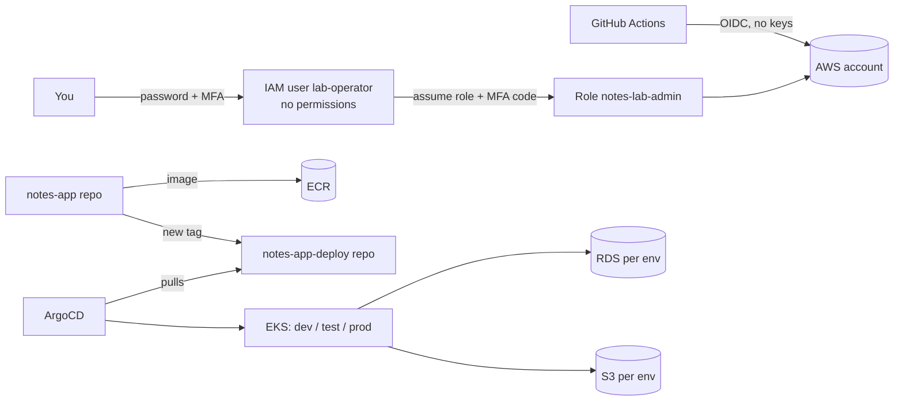

# notes-lab — Step-by-step guide (for beginners)

AWS account: **509306733905** · Region: **ap-south-1 (Mumbai)**

You will build, on ONE AWS account: one EKS cluster with three namespaces (`dev`, `test`, `prod`).
Each namespace has its own MySQL database (RDS) and its own S3 bucket. Terraform builds the
infrastructure, GitHub Actions builds the app, ArgoCD deploys it.

**How to use this guide**
* Do the parts in order. Do not skip.
* Every grey box = copy and paste into the terminal. Lines starting with `#` are comments.
* After each step there is **"You should see"**. If you do not see it, stop and go to Part 11 (Troubleshooting).
* Replace only the things written like `<THIS>`. Everything else is already filled for you.
* Time needed: about 3 to 4 hours the first time (most of it is waiting for AWS).

**Big picture**



---------------------------------------------------------------------

## Part 0 — Install tools on your laptop (30 min)

**Windows users:** open PowerShell **as Administrator**, run `wsl --install -d Ubuntu`, restart the PC,
open "Ubuntu" from the Start menu and create a username/password. Do **everything below inside Ubuntu**.
**Mac users:** open "Terminal" and use the Mac block.

### 0.1 Ubuntu / WSL
```bash
sudo apt-get update && sudo apt-get install -y unzip curl wget jq git gnupg lsb-release perl

# AWS CLI v2
curl -s "https://awscli.amazonaws.com/awscli-exe-linux-x86_64.zip" -o /tmp/awscliv2.zip
unzip -q -o /tmp/awscliv2.zip -d /tmp && sudo /tmp/aws/install --update

# Terraform
wget -qO- https://apt.releases.hashicorp.com/gpg | sudo gpg --dearmor --yes -o /usr/share/keyrings/hashicorp-archive-keyring.gpg
echo "deb [signed-by=/usr/share/keyrings/hashicorp-archive-keyring.gpg] https://apt.releases.hashicorp.com $(lsb_release -cs) main" | sudo tee /etc/apt/sources.list.d/hashicorp.list
sudo apt-get update && sudo apt-get install -y terraform

# kubectl
curl -sLO "https://dl.k8s.io/release/$(curl -sL https://dl.k8s.io/release/stable.txt)/bin/linux/amd64/kubectl"
sudo install -m 0755 kubectl /usr/local/bin/kubectl && rm kubectl

# yq
sudo curl -sL https://github.com/mikefarah/yq/releases/latest/download/yq_linux_amd64 -o /usr/local/bin/yq && sudo chmod +x /usr/local/bin/yq

# GitHub CLI
sudo mkdir -p -m 755 /etc/apt/keyrings
wget -qO- https://cli.github.com/packages/githubcli-archive-keyring.gpg | sudo tee /etc/apt/keyrings/githubcli-archive-keyring.gpg > /dev/null
sudo chmod go+r /etc/apt/keyrings/githubcli-archive-keyring.gpg
echo "deb [arch=$(dpkg --print-architecture) signed-by=/etc/apt/keyrings/githubcli-archive-keyring.gpg] https://cli.github.com/packages stable main" | sudo tee /etc/apt/sources.list.d/github-cli.list > /dev/null
sudo apt-get update && sudo apt-get install -y gh
```

### 0.1b Mac (instead of 0.1)
```bash
brew install awscli kubectl jq yq gh git
brew tap hashicorp/tap && brew install hashicorp/tap/terraform
```

### 0.2 Check
```bash
aws --version; terraform version | head -1; kubectl version --client | head -1; jq --version; yq --version; gh --version | head -1
```
**You should see:** a version for every tool. `aws-cli` must be **2.32 or newer** (needed for `aws login`).
If it is older: run the AWS CLI install lines again (Ubuntu) or `brew upgrade awscli` (Mac).

### 0.3 Authenticator app
Install Google Authenticator / Microsoft Authenticator / Authy on your phone. You will add **two** entries
(one for root, one for the IAM user).

---------------------------------------------------------------------

## Part 1 — Secure the AWS account (30 min, in the browser)

**Why:** The root user is the owner of the account; it can do anything and cannot be restricted.
We lock it with MFA and never use it again. Daily work is done by a normal IAM user that has
*no permissions by itself* and must use MFA to become admin.

### 1.1 Root user MFA
1. Go to https://console.aws.amazon.com → **Sign in** → "Root user" → email + password.
2. Top-right: click your account name → **Security credentials**.
3. **Multi-factor authentication (MFA)** → **Assign MFA device** → Device name: `root-mfa` → *Authenticator app* → scan QR → enter two codes → Add.
4. On the same page, **Access keys** must be empty. If any key exists, delete it.

**You should see:** MFA device `root-mfa` listed, and "No access keys".

### 1.2 Check your plan and credits
Console search bar → **Billing and Cost Management** → look at the top banner / **Credits**.
* If it says you are on the **Free plan** and any later step says "not available on the free plan",
  click **Upgrade plan**. Upgrading yourself keeps your unused credits (do not join/create an AWS Organization).
* Do **not** create an AWS Organization. It is not needed here.

### 1.3 Create your daily-use IAM user
1. Console search → **IAM** → **Users** → **Create user**.
2. User name: `lab-operator`. Tick **Provide user access to the AWS Management Console** → **I want to create an IAM user**.
3. Choose **Custom password**, type a long password (save it in a password manager). Untick "must create new password".
4. **Next** → **Attach policies directly** → search `AdministratorAccess` → tick it → **Next** → **Create user**.

   > This admin policy is **temporary**. In Part 3 you will remove it. After that the user can do nothing
   > except ask for the MFA-protected admin role.
5. Copy the **Console sign-in URL** shown. It is: `https://509306733905.signin.aws.amazon.com/console`

### 1.4 MFA for the IAM user
1. Open a **private/incognito window** → open the sign-in URL above → "IAM user" → username `lab-operator` + password.
2. Top-right: account name → **Security credentials** → **Assign MFA device**.
3. Device name must be exactly: **`lab-operator`** (important, later commands depend on this name).
4. Authenticator app → scan → two codes → Add.
5. Sign out and sign in again, check that it asks for a code.
6. In the top-right corner set the region to **Asia Pacific (Mumbai) ap-south-1**.

**Do NOT create access keys** for this user. We will use `aws login` (short-lived credentials) instead.

---------------------------------------------------------------------

## Part 2 — Get the files and prepare them (10 min)

### 2.1 Unzip
Put `notes-lab.zip` in your Linux home folder. In WSL you can copy it from Windows Downloads:
```bash
mkdir -p ~/lab && cd ~/lab
cp /mnt/c/Users/<YOUR_WINDOWS_USERNAME>/Downloads/notes-lab.zip .     # Mac: cp ~/Downloads/notes-lab.zip .
unzip -o notes-lab.zip && ls
```
**You should see:** `00-RUNBOOK.md  00-prepare.sh  notes-app  notes-app-deploy  notes-lab-infra`

### 2.2 Login to GitHub from the terminal
```bash
gh auth login --scopes "repo,workflow"
```
Choose: GitHub.com → HTTPS → **Yes** (authenticate Git) → Login with a web browser → copy the code, paste in browser, Authorize.
```bash
export GH_USER=$(gh api user --jq .login)
echo "My GitHub user: $GH_USER"
git config --global user.name "$GH_USER"
git config --global user.email "<YOUR_EMAIL>"
```

### 2.3 Prepare files
```bash
cd ~/lab
./00-prepare.sh "$GH_USER" "<YOUR_EMAIL>"
```
**You should see:** `OK: bootstrap`, `OK: platform`, `OK: addons`, then "All good".
(It downloads Terraform modules; takes 1–3 minutes.) If any shows FAILED, copy the message and ask for help; do not continue.

---------------------------------------------------------------------

## Part 3 — Bootstrap: create the foundation (25 min)

**What this builds (once):** the Terraform state bucket, the GitHub-to-AWS trust (OIDC, so GitHub never holds AWS keys),
the two MFA-protected human roles (`notes-lab-admin`, `notes-lab-readonly`), CloudTrail (audit log), a budget alarm,
and account-wide guard-rails (strong password policy, S3 public access blocked, EBS encryption default, IMDSv2 only,
IAM Access Analyzer, GuardDuty).

### 3.1 Login with `aws login`
```bash
aws login --profile lab-login
```
Region: `ap-south-1`. A browser opens → choose **Continue with Root or IAM user** → Account ID `509306733905`,
IAM user `lab-operator`, password, then the MFA code → **Allow**. Go back to the terminal.
```bash
aws sts get-caller-identity --profile lab-login
```
**You should see:** an `Arn` ending with `user/lab-operator`.

### 3.2 Give Terraform the temporary credentials
```bash
eval "$(aws configure export-credentials --profile lab-login --format env)"
unset AWS_PROFILE
aws sts get-caller-identity
```
These credentials expire in a few minutes. If a later command says `ExpiredToken`, just run 3.2 again.

### 3.3 Create everything
```bash
cd ~/lab/notes-lab-infra/bootstrap
terraform init
terraform plan -out=tfplan
```
Read the plan summary. It should say about **35–45 to add, 0 to change, 0 to destroy**.
```bash
terraform apply tfplan
```
**You should see:** `Apply complete!` and outputs such as `tf_plan_role_arn`, `admin_role_arn`.

### 3.4 Move the state into S3 (so it is not only on your laptop)
```bash
cp backend.tf.example backend.tf
terraform init -migrate-state -force-copy
rm -f tfplan terraform.tfstate terraform.tfstate.backup
```
**You should see:** "Successfully configured the backend s3".

### 3.5 Make the admin profile (MFA required)
```bash
mkdir -p ~/.aws
cat >> ~/.aws/config <<'EOF'

[profile lab-admin]
role_arn = arn:aws:iam::509306733905:role/notes-lab-admin
source_profile = lab-login
mfa_serial = arn:aws:iam::509306733905:mfa/lab-operator
duration_seconds = 14400
region = ap-south-1

[profile lab-readonly]
role_arn = arn:aws:iam::509306733905:role/notes-lab-readonly
source_profile = lab-login
mfa_serial = arn:aws:iam::509306733905:mfa/lab-operator
duration_seconds = 14400
region = ap-south-1
EOF

cat >> ~/.bashrc <<'EOF'

# Start an admin session (asks for your MFA code, valid 4 hours)
labenv() {
  aws sts get-caller-identity --profile lab-admin >/dev/null \
  && eval "$(aws configure export-credentials --profile lab-admin --format env)" \
  && unset AWS_PROFILE \
  && echo "Admin session ready for ~4 hours"
}
EOF
source ~/.bashrc
labenv
aws sts get-caller-identity
```
Type the 6-digit MFA code when asked.
**You should see:** `assumed-role/notes-lab-admin/...`

### 3.6 Remove the temporary admin power from the IAM user  (very important)
```bash
aws iam detach-user-policy --user-name lab-operator --policy-arn arn:aws:iam::aws:policy/AdministratorAccess
aws iam list-attached-user-policies --user-name lab-operator
aws iam list-access-keys --user-name lab-operator
```
**You should see:** only `notes-lab-operator-assume-roles` attached, and `"AccessKeyMetadata": []`.
From now on the user can do nothing alone. Admin work needs the role + MFA code.

> **Plan B** — only if `aws login` does not work in 3.1 and you cannot fix it: ask me for the "temporary access key"
> variant. Do not create a long-lived key on your own.

---------------------------------------------------------------------

## Part 4 — GitHub repositories and settings (20 min)

**Why public for the infra repo?** The approval gate ("Environment with required reviewers") is available on private
repos only with a paid GitHub plan. The infra repo has **no passwords** (only names and your account number),
so public is acceptable for a lab. The app and deploy repos stay **private**.

### 4.1 Create the repos
```bash
cd ~/lab
for r in notes-lab-infra notes-app notes-app-deploy; do
  (cd $r && git init -q -b main && git add -A && git commit -q -m "initial commit")
done
gh repo create "$GH_USER/notes-lab-infra"   --public  --source=notes-lab-infra   --remote=origin
gh repo create "$GH_USER/notes-app"         --private --source=notes-app         --remote=origin
gh repo create "$GH_USER/notes-app-deploy"  --private --source=notes-app-deploy  --remote=origin
```
Push only the deploy repo now (ArgoCD will read it):
```bash
git -C notes-app-deploy push -u origin main
```

### 4.2 The approval gate for infra (Environment `production-infra`)
```bash
MY_ID=$(gh api user --jq .id)
cat > /tmp/env.json <<EOF
{"reviewers":[{"type":"User","id":$MY_ID}],"deployment_branch_policy":{"protected_branches":false,"custom_branch_policies":true}}
EOF
gh api -X PUT "repos/$GH_USER/notes-lab-infra/environments/production-infra" --input /tmp/env.json
gh api -X POST "repos/$GH_USER/notes-lab-infra/environments/production-infra/deployment-branch-policies" -f name=main -f type=branch
```
**You should see:** JSON output with `"name": "production-infra"`.
This means: any AWS-changing job must be **approved by you in GitHub**, and only code on branch `main` can ask.

### 4.3 Settings the pipeline needs (variables, not secrets)
```bash
R="$GH_USER/notes-lab-infra"
gh variable set TF_STATE_BUCKET  -R $R --body "notes-lab-509306733905-tfstate"
gh variable set AWS_REGION       -R $R --body "ap-south-1"
gh variable set TF_PLAN_ROLE_ARN  -R $R --body "arn:aws:iam::509306733905:role/notes-lab-gha-terraform-plan"
gh variable set TF_APPLY_ROLE_ARN -R $R --body "arn:aws:iam::509306733905:role/notes-lab-gha-terraform-apply"
gh variable list -R $R
```
Note: these are ARNs, not passwords. There is **no AWS key stored in GitHub anywhere**.

### 4.4 One browser setting (30 seconds)
GitHub → `notes-lab-infra` → **Settings → Actions → General** → *Fork pull request workflows from outside collaborators*
→ select **Require approval for all outside collaborators** → Save.

---------------------------------------------------------------------

## Part 5 — Build the platform with the pipeline (40 min, mostly waiting)

### 5.1 Push the infra repo (this starts the pipeline)
```bash
git -C ~/lab/notes-lab-infra push -u origin main
gh run list -R "$GH_USER/notes-lab-infra" --limit 3
```
Open the repo on GitHub → **Actions** tab → workflow **Terraform**.

### 5.2 Review and approve the platform plan
1. Wait until the job `platform / plan (platform)` is green.
2. Click it → **Summary** (page bottom: "Terraform plan — platform"). Read it. It should say **to add, 0 to destroy**.
3. The next job `apply (platform)` shows **"Waiting"**. Click **Review deployments** → tick `production-infra` → **Approve and deploy**.
4. Wait ~15–25 min (EKS and RDS are slow).

### 5.3 Approve add-ons
After platform finishes, the same flow runs for `addons`: plan → **approve** → apply (~5 min).

**You should see:** both layers green.

### 5.4 Connect your terminal to the cluster
```bash
labenv
aws eks update-kubeconfig --name notes-lab --region ap-south-1
kubectl get nodes
kubectl get pods -A
```
**You should see:** 2 nodes `Ready`; pods for `argocd`, `external-secrets`, `kube-system`.
(If `Unauthorized`: run `labenv` again and see Part 11.)

---------------------------------------------------------------------

## Part 6 — Connect infra to the deployment repo (15 min)

### 6.1 Copy the non-secret values (DB host, secret ARN) into the deploy repo
```bash
labenv
cd ~/lab/notes-lab-infra/platform
cp backend.hcl.example backend.hcl
terraform init -backend-config=backend.hcl
terraform output -json > /tmp/tf-out.json

cd ~/lab/notes-app-deploy
./scripts/render-env-config.sh /tmp/tf-out.json
rm /tmp/tf-out.json
git diff --stat
git add -A && git commit -m "render env config from terraform outputs" && git push
```
**You should see:** `rendered dev`, `rendered test`, `rendered prod`.

### 6.2 Let ArgoCD read your private deploy repo (read-only token)
1. GitHub → your profile picture → **Settings** → **Developer settings** → **Personal access tokens** → **Fine-grained tokens** → **Generate new token**.
2. Name `argocd-read-deploy`, Expiration **90 days**, Repository access: **Only select repositories → notes-app-deploy**.
3. Permissions → Repository permissions → **Contents: Read-only** (nothing else). Generate. Copy the token.
```bash
read -s -p "Paste the READ-ONLY token and press Enter: " ARGO_PAT; echo
kubectl -n argocd create secret generic repo-deploy \
  --from-literal=type=git \
  --from-literal=url="https://github.com/$GH_USER/notes-app-deploy.git" \
  --from-literal=username="$GH_USER" \
  --from-literal=password="$ARGO_PAT"
kubectl -n argocd label secret repo-deploy argocd.argoproj.io/secret-type=repository
unset ARGO_PAT
```
Wait 2–3 minutes:
```bash
kubectl -n argocd get applications
```
**You should see:** `root` Synced, and `notes-app-dev`, `notes-app-test`, `notes-app-prod` listed
(they may show `Degraded/Progressing` because no image exists yet — that is expected).

### 6.3 Open ArgoCD and secure its login
```bash
kubectl -n argocd port-forward svc/argocd-server 8080:443
```
Leave it running. Open **https://localhost:8080** (accept the certificate warning). User `admin`.
Password (open a second terminal, run `labenv` first):
```bash
kubectl -n argocd get secret argocd-initial-admin-secret -o jsonpath='{.data.password}' | base64 -d; echo
```
Then in the ArgoCD UI: **User Info → Update Password** (set a strong one), and delete the initial secret:
```bash
kubectl -n argocd delete secret argocd-initial-admin-secret
```
Stop the port-forward with `Ctrl+C` when done.

---------------------------------------------------------------------

## Part 7 — The application: first build and deploy to dev (20 min)

### 7.1 Token that lets the app pipeline update the deploy repo (read + write)
Create another fine-grained token: name `app-ci-write-deploy`, 90 days, **only notes-app-deploy**,
**Contents: Read and write**. Then:
```bash
A="$GH_USER/notes-app"
read -s -p "Paste the READ+WRITE token and press Enter: " P; echo
gh secret set DEPLOY_REPO_TOKEN -R $A --body "$P"; unset P

gh variable set AWS_ROLE_ARN         -R $A --body "arn:aws:iam::509306733905:role/notes-lab-gha-app-ecr-push"
gh variable set AWS_REGION           -R $A --body "ap-south-1"
gh variable set ECR_REPOSITORY_URL   -R $A --body "509306733905.dkr.ecr.ap-south-1.amazonaws.com/notes-app"
gh variable set DEPLOY_REPO          -R $A --body "$GH_USER/notes-app-deploy"
```
(That token is the **only stored secret** in the whole project. Put a reminder to rotate it every 90 days.)

### 7.2 Push the app
```bash
git -C ~/lab/notes-app push -u origin main
gh run watch -R "$GH_USER/notes-app"
```
The pipeline does: lint + tests → build image → security scan (Trivy) → push to ECR → writes the new
image tag into `notes-app-deploy` (dev). ArgoCD sees it and deploys in about 3 minutes.

### 7.3 Check dev
```bash
labenv
kubectl -n dev get pods
kubectl -n dev get externalsecret,secret
kubectl -n dev port-forward svc/notes-app 8081:80
```
Open **http://localhost:8081**. Add a note, attach a small file, save.

**You should see:** pod `1/1 Running`, ExternalSecret `SecretSynced`, and your note on the page.
Check the file really went to S3 (second terminal, `labenv` first):
```bash
aws s3 ls s3://notes-lab-509306733905-dev-uploads/notes/ --recursive
```

---------------------------------------------------------------------

## Part 8 — Promote: dev → test → prod (15 min)

The same image is copied forward; nothing is rebuilt.

### 8.1 dev → test
```bash
gh workflow run "Promote image" -R "$GH_USER/notes-app-deploy" -f from_env=dev -f to_env=test
```
Wait 30 sec, then open the Pull Request it created:
```bash
gh pr list -R "$GH_USER/notes-app-deploy"
gh pr merge <PR_NUMBER> -R "$GH_USER/notes-app-deploy" --squash
```
If the workflow says it cannot create pull requests: GitHub → `notes-app-deploy` → Settings → Actions → General →
tick **Allow GitHub Actions to create and approve pull requests** → Save, run again.
ArgoCD auto-syncs **test** within 3 minutes: `kubectl -n test get pods`.

### 8.2 test → prod (needs your manual Sync)
```bash
gh workflow run "Promote image" -R "$GH_USER/notes-app-deploy" -f from_env=test -f to_env=prod
gh pr list -R "$GH_USER/notes-app-deploy"
gh pr merge <PR_NUMBER> -R "$GH_USER/notes-app-deploy" --squash
```
Now open ArgoCD (port-forward as in 6.3) → application **notes-app-prod** → status `OutOfSync` → **Diff** (read it)
→ **Sync** → Synchronize. Prod never changes without a human pressing Sync.

Get the public address of prod:
```bash
kubectl -n prod get ingress notes-app
```
After 2–3 minutes the `ADDRESS` column shows an `...elb.amazonaws.com` name. Open `http://<that-name>`.
(It is HTTP only for now; Part 12 explains HTTPS with a domain.)

---------------------------------------------------------------------

## Part 9 — Prove that the security is real (15 min)

Run `labenv` first. Each test says what you must see.

```bash
# 1. Root has MFA and no keys
aws iam get-account-summary --query 'SummaryMap.[AccountMFAEnabled,AccountAccessKeysPresent]'
#   expect: [1, 0]

# 2. Your IAM user has no keys and no direct admin
aws iam list-access-keys --user-name lab-operator
#   expect: empty list

# 3. S3 buckets are private and encrypted with KMS
aws s3api get-public-access-block --bucket notes-lab-509306733905-prod-uploads
aws s3api get-bucket-encryption   --bucket notes-lab-509306733905-prod-uploads
#   expect: all four "true"; SSEAlgorithm aws:kms

# 4. Databases are private, encrypted
aws rds describe-db-instances --query 'DBInstances[].[DBInstanceIdentifier,PubliclyAccessible,StorageEncrypted]' --output table
#   expect: PubliclyAccessible False, StorageEncrypted True for dev, test, prod

# 5. Audit log is running
aws cloudtrail get-trail-status --name notes-lab-trail --query IsLogging
#   expect: true

# 6. ISOLATION TEST: a pod in "dev" must NOT be able to read prod's DB password
PROD_SECRET=$(aws rds describe-db-instances --db-instance-identifier notes-lab-prod --query 'DBInstances[0].MasterUserSecret.SecretArn' --output text)
kubectl -n dev run isolation-test --rm -it --restart=Never --image=amazon/aws-cli \
  --overrides='{"spec":{"serviceAccountName":"notes-app","securityContext":{"runAsNonRoot":true,"runAsUser":10001,"seccompProfile":{"type":"RuntimeDefault"}},"containers":[{"name":"isolation-test","image":"amazon/aws-cli","args":["secretsmanager","get-secret-value","--secret-id","'"$PROD_SECRET"'","--region","ap-south-1"],"securityContext":{"allowPrivilegeEscalation":false,"capabilities":{"drop":["ALL"]}}}]}}'
#   expect: AccessDeniedException   (dev role cannot read the prod secret)

# 7. Pipeline cannot be abused: GitHub holds no AWS keys
gh secret list -R "$GH_USER/notes-lab-infra"     # expect: empty
gh secret list -R "$GH_USER/notes-app"           # expect: only DEPLOY_REPO_TOKEN
```
(Test 6 may fail to start if the network policy blocks the temporary pod's DNS in `dev`. That is also a pass for isolation,
but then try the test in the `kube-system` style: ask me and I will give a variant.)

---------------------------------------------------------------------

## Part 10 — Every day use, and how to save money

**Start of a work session (every 4 hours):**
```bash
labenv                       # asks for the MFA code
aws eks update-kubeconfig --name notes-lab --region ap-south-1    # only needed on a new laptop
```
Use `--profile lab-readonly` (instead of `lab-admin`) when you only want to look.

**Cost:** the whole lab is roughly **$250/month if left running 24×7 (about $0.35/hour)**. Your AWS credits can finish
in a few weeks. Practise, then **switch it off**:

* GitHub → `notes-lab-infra` → Actions → **Destroy everything (cost saver)** → Run workflow → type `destroy` → approve.
* First time only: prod DB has delete protection. Open `notes-lab-infra/platform/variables.tf`, set prod
  `db_deletion_protection = false`, commit, let the Terraform workflow apply, then run Destroy.
* The foundation from Part 3 stays (it costs very little). To bring the lab back: push any small change to
  `notes-lab-infra` (or run the **Terraform** workflow manually) and approve; then repeat Part 6 and 6.2 (ArgoCD token secret).
* Data in dev/test is lost on destroy. Prod keeps a final snapshot.

---------------------------------------------------------------------

## Part 11 — Troubleshooting

| Problem | Reason | Fix |
|---|---|---|
| `ExpiredToken` / `ExpiredTokenException` | temporary credentials ended | run `labenv` again (Part 3.2 for bootstrap) |
| `AccessDenied` when assuming `notes-lab-admin` | MFA code wrong/expired, or MFA device name is not `lab-operator` | type the next code; check IAM → Users → lab-operator → MFA device name |
| `aws login` unknown command | old AWS CLI | upgrade CLI (Part 0.2) |
| `kubectl`: `Unauthorized` / `You must be logged in` | no session or cluster not ready | `labenv`, then `aws eks update-kubeconfig ...` again |
| GitHub job waits forever "Waiting" | needs your approval | Actions → run → Review deployments → approve |
| Terraform job: `Not authorized to perform sts:AssumeRoleWithWebIdentity` | GitHub variable wrong, or branch is not `main` | `gh variable list -R ...`; run only from `main` |
| `terraform validate` fails in Part 2.3 | module/provider version changed | send me the message |
| Error: `detector already exists` (GuardDuty) | GuardDuty was already on | set `enable_guardduty = false` in `bootstrap/terraform.tfvars` and apply again |
| Pod `ImagePullBackOff` in dev | first image not pushed yet | wait for the app pipeline (Part 7.2) |
| ExternalSecret `SecretSyncedError` | role/secret ARN wrong | re-run Part 6.1 (`render-env-config.sh`) and push |
| ArgoCD app `Unknown` / repo error | token secret missing or expired | redo Part 6.2 |
| Prod ingress has no ADDRESS after 5 min | ALB controller | `kubectl -n kube-system logs deploy/aws-load-balancer-controller` and send me the last lines |
| Destroy stuck at VPC | an ALB still exists | the workflow deletes ingresses first; otherwise delete the load balancer in EC2 console, rerun |
| Pipeline: `RequestLimitExceeded`/capacity | temporary AWS issue | re-run the failed job |

---------------------------------------------------------------------

## Part 12 — What is production-grade here, and what to do next

**Already in place**

| Area | What is done |
|---|---|
| Root account | MFA, no access keys, not used |
| Human access | IAM user with zero permissions → MFA-protected admin / readonly roles, 4-hour sessions, no access keys |
| CI/CD access | GitHub OIDC only; plan role read-only; apply role only via approved environment on `main`; app role can only push to one ECR repo |
| Account guard-rails | password policy, account-wide S3 block public access, EBS default encryption, IMDSv2 required, Access Analyzer, GuardDuty, CloudTrail (log validation) |
| Network | nodes and DB in private subnets, DB subnets have no internet route, S3 gateway endpoint, NetworkPolicy default-deny |
| Data | per-env RDS (encrypted, backups, private) and S3 (versioned, KMS, TLS-only, private), per-env KMS key; DB password never in git or Terraform state |
| Pod identity | IRSA, one role per namespace, only its own bucket / secret / key |
| Kubernetes | Pod Security `restricted`, non-root, read-only filesystem, ResourceQuota, per-env ArgoCD project |
| Supply chain | immutable image tags, scan on push + Trivy gate, same image promoted dev → test → prod |
| Change control | prod = PR review + manual ArgoCD Sync (inside a time window) |
| Cost control | budget alarm, destroy workflow |

**Known gaps (be honest in interviews)**
1. One account only: the account is the real security boundary. Namespaces are *logical* separation. With a second account, prod should move there.
2. The Terraform apply role is AdministratorAccess (protected by who can use it). Tighten with a permission boundary later.
3. EKS API endpoint is public (IAM required); GitHub-hosted runners have no fixed IPs. Next level: private endpoint + self-hosted runner.
4. One NAT gateway and single-AZ databases to save money. For real HA: `single_nat_gateway = false`, `db_multi_az = true` for prod.
5. HTTP only. Next: buy a domain → ACM certificate → Route 53 → HTTPS annotations in `overlays/prod/ingress.yaml`.
6. The app uses the RDS master user and creates its table at start. Next: a least-privilege DB user and a migration Job.
7. ArgoCD has a local admin. Next: GitHub SSO (Dex) and RBAC.
8. Fine-grained tokens expire in 90 days — rotate them (or move to a GitHub App).

**Disaster Recovery plan (your next stage)**
1. Restore drills: restore prod RDS from a snapshot into a new DB; restore a deleted S3 object from its old version.
2. Write RPO/RTO targets for prod (example: RPO 15 min, RTO 2 hours).
3. Cross-region (Mumbai → Hyderabad `ap-south-2`): S3 Cross-Region Replication (versioning is already on), RDS cross-region read replica or replicated backups, ECR replication, Secrets Manager replica, multi-Region KMS keys.
4. Pilot-light second cluster from the same Terraform in the DR region + ArgoCD overlay `prod-dr`.
5. Failover with Route 53 (needs a domain), then a game-day test.

Already prepared for DR: everything is code, S3 versioning, per-env KMS keys, immutable images, region is a variable.

**What I could not verify:** I could not run `terraform plan/apply` or `kubectl` from my side (no AWS access). I checked syntax and ran the app tests. Part 2.3 runs `terraform validate` on your laptop,
so most problems show up there. If any step fails, paste the exact error and I will fix the files.
